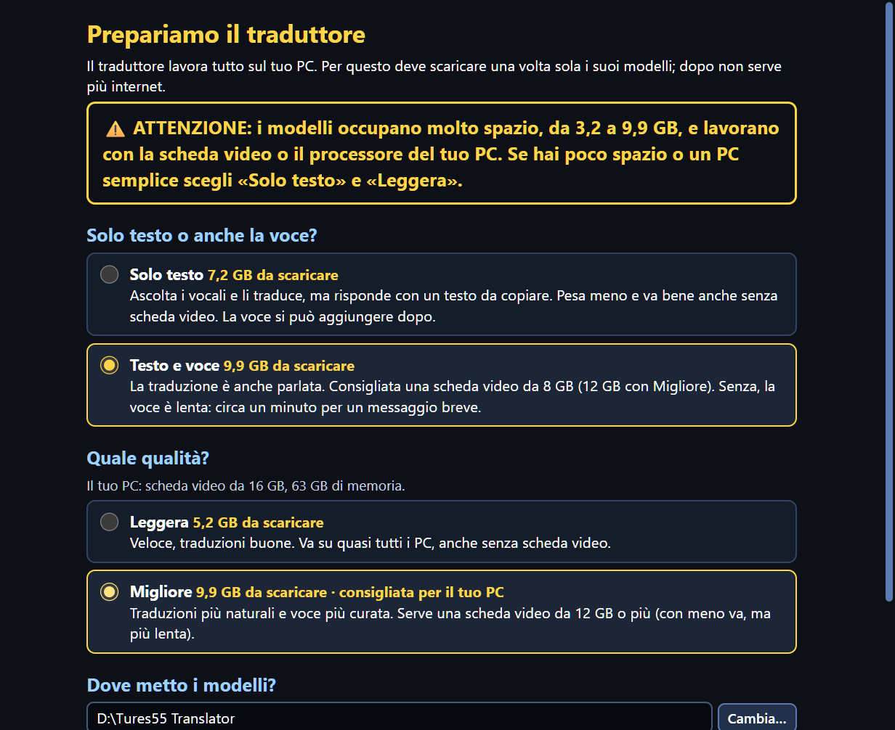
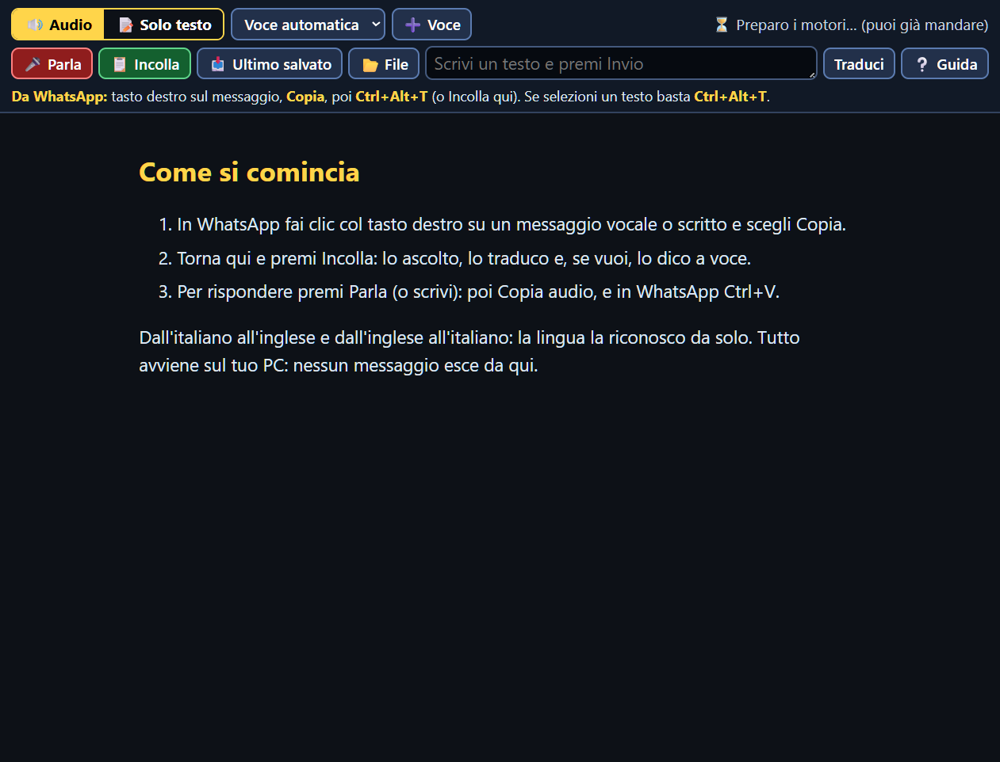

# Guida del traduttore vocale

[English guide](GUIDE.md) · [Scarica](https://github.com/Tures55/voice-message-translator-windows/releases/latest/download/Tures55-Translator-Setup.exe)

- [Installare](#installare)
- [Cosa fa](#cosa-fa)
- [La prima volta](#la-prima-volta)
- [Tradurre un messaggio ricevuto](#tradurre-un-messaggio-ricevuto)
- [Rispondere](#rispondere)
- [La scorciatoia Ctrl+Alt+T](#la-scorciatoia-ctrlaltt)
- [Audio oppure Solo testo](#audio-oppure-solo-testo)
- [Le lingue dei messaggi](#le-lingue-dei-messaggi)
- [Le voci](#le-voci)
- [Controllare la traduzione](#controllare-la-traduzione)
- [WhatsApp in automatico](#whatsapp-in-automatico)
- [Cambiare qualità o cartella](#cambiare-qualità-o-cartella)
- [Scheda video](#scheda-video)
- [Scritte più grandi](#scritte-più-grandi)
- [I tuoi messaggi](#i-tuoi-messaggi)
- [Se qualcosa non va](#se-qualcosa-non-va)
- [Aggiornamenti](#aggiornamenti)
- [Con cosa è fatto](#con-cosa-è-fatto)

## Installare

1. Scarica [Tures55-Translator-Setup.exe](https://github.com/Tures55/voice-message-translator-windows/releases/latest/download/Tures55-Translator-Setup.exe) e aprilo.
2. Se Windows avvisa che il programma non è riconosciuto, premi «Ulteriori informazioni» e poi «Esegui comunque»: succede ai programmi gratuiti senza firma a pagamento.
3. Segui i passi. Non serve l'amministratore.

## Cosa fa

Ascolta un messaggio vocale o legge un messaggio scritto, capisce da solo in quale delle due lingue scelte è, lo traduce nell'altra e, in dieci lingue, se vuoi te lo dice anche a voce. Va bene per WhatsApp, Telegram, le email e qualsiasi programma da cui si può copiare.

Tutto avviene sul tuo PC: nessun messaggio viene mandato su internet.

## La prima volta

ATTENZIONE allo spazio: il programma scarica i suoi modelli una volta sola. Solo testo: 3,2 GB (Leggera) o 7,7 GB (Migliore). Testo e voce: 5,2 GB (Leggera) o 10,4 GB (Migliore).

Scegli tra Solo testo e Testo e voce, poi la qualità (il programma ti dice quale va meglio per il tuo PC) e la cartella dove mettere i modelli. Poi premi Scarica: se lo fermi o cade internet, riprende da dove era.

Alla prima apertura e dopo un aggiornamento i motori ci mettono un po' di più a prepararsi: puoi già mandare i messaggi, aspettano in coda.

## Tradurre un messaggio ricevuto

1. In WhatsApp fai clic col tasto destro sul messaggio (vocale o scritto) e scegli Copia.
2. Nel traduttore premi Incolla, oppure Ctrl+V.

Funzionano anche:

- File: scegli un audio dal PC.
- Trascinare un audio dentro la finestra.
- Ultimo salvato: l'ultimo audio che WhatsApp ha salvato sul PC. L'ultimo ricevuto, se non l'hai copiato o salvato, WhatsApp non lo mette sul PC: in quel caso usa Copia.
- In Esplora File: tasto destro su un audio, Invia a, Tures55 Translator (in Windows 11 prima «Mostra altre opzioni»).

## Rispondere

Premi Parla, di' il messaggio nella tua lingua e premi «Ho finito, traduci». Oppure scrivi il testo e premi Invio (Maiusc+Invio va a capo).

Poi premi Copia audio (o Copia testo), vai nella chat e premi Ctrl+V.

Puoi correggere la traduzione nella casella grande: premi Rifai la voce e l'audio viene rifatto col testo corretto.

## La scorciatoia Ctrl+Alt+T

Vale in qualsiasi programma finché il traduttore è aperto. Traduce quello che hai copiato e porta avanti la finestra del traduttore.

Con WhatsApp davanti copia anche da sola il testo selezionato.

Se un altro programma usa già questi tasti, il traduttore ne prende altri: li vedi scritti in alto nella finestra.

## Audio oppure Solo testo

L'interruttore giallo in alto decide cosa avere per i messaggi nuovi, e viene ricordato.

Solo testo è più veloce e libera la scheda video. Se poi ti serve la voce di un messaggio, premi Crea l'audio.

## Le lingue dei messaggi

In alto scegli la tua lingua e quella dell'altro: vengono ricordate.

La traduzione può essere anche a voce in dieci lingue: italiano, inglese, spagnolo, francese, tedesco, portoghese, russo, cinese, giapponese e coreano. Nelle altre lingue è solo scritta: i vocali si ascoltano e si traducono lo stesso, ma la risposta è un testo da copiare. Con una lingua che ha la voce e una che non ce l'ha, la voce c'è solo quando si traduce verso la prima.

Se i messaggi corti vengono presi per l'altra lingua, premi Altro verso.

## Le voci

- Voce automatica: i messaggi che mandi tu escono con la tua voce nell'altra lingua; quelli che ricevi li legge una voce nella tua lingua.
- Voce di chi parla: sempre la voce di chi ha registrato il messaggio.
- Voce di donna e Voce di uomo: voci incluse nel programma, fatte al computer.
- ➕ Voce: aggiunge una voce tua da un audio di 3-15 secondi con una persona sola che parla, senza musica.

Usa solo la tua voce o quella di chi ti ha dato il permesso, e di' a chi ascolta che la voce è stata fatta al computer.

Le voci aggiunte sono nella cartella che si apre da Traduttore, «Apri la cartella delle mie voci»: per toglierne una cancella i suoi due file.

## Controllare la traduzione

Quando la traduzione è nell'altra lingua, il programma la rilegge nella tua, in verde: se il senso è giusto puoi mandarla.

Se ha scambiato la lingua del messaggio, premi Altro verso.

È una traduzione automatica e può sbagliare: per cose importanti (salute, contratti, soldi) fatela controllare a una persona.

## WhatsApp in automatico

Quando WhatsApp per Windows salva un audio sul PC (perché lo copi, lo salvi o lo apri), il traduttore lo traduce da solo. Si spegne dal menu Traduttore.

Il programma non entra in WhatsApp e non legge le tue chat: guarda solo gli audio che WhatsApp mette nelle sue cartelle e in Download.

Tures55 Translator non è fatto da WhatsApp o Meta e non è collegato a loro.

## Cambiare qualità o cartella

Dal menu Traduttore, «Qualità, voce e cartella dei modelli…». Puoi passare da Leggera a Migliore, aggiungere la voce o spostarti in un'altra cartella. I modelli che non servono più si possono cancellare: te lo chiede il programma.

## Scheda video

Di solito va bene Automatica: il programma sceglie la scheda con più memoria libera, e se non basta usa il processore. Va con schede NVIDIA, AMD e Intel.

Dopo 10 minuti senza lavoro i motori si spengono e liberano la memoria; si riaccendono da soli al messaggio dopo.

## Scritte più grandi

Ctrl e + ingrandisce, Ctrl e - rimpicciolisce, Ctrl e 0 torna normale. La misura viene ricordata.

La lingua delle scritte del programma si cambia dal menu Traduttore, Lingua.

## I tuoi messaggi

Le traduzioni e i loro audio restano solo sul tuo PC. Con Elimina ne cancelli una; dal menu Traduttore, «Cancella tutte le traduzioni…».

Il programma usa internet solo per scaricare i modelli, cercare aggiornamenti e, se lo chiedi tu, per mandare una segnalazione.

## Se qualcosa non va

- «Il motore si è fermato»: di solito la scheda video è occupata da un altro programma (per esempio un gioco). Chiudilo e premi Riprova, oppure scegli un'altra scheda o la qualità Leggera.
- Molto lento: passa alla qualità Leggera o a Solo testo. Senza una scheda video la voce ci mette circa un minuto per un messaggio breve, il testo pochi secondi.
- Il microfono non va: in Windows apri Impostazioni, Privacy, Microfono, e permetti l'accesso alle app desktop.
- Windows avvisa che il programma non è riconosciuto quando lo installi: premi «Ulteriori informazioni», poi «Esegui comunque».

Per avvisare l'autore: menu Aiuto, «Segnala un problema…».

## Aggiornamenti

Il programma si aggiorna da solo: scarica la versione nuova e la installa alla chiusura. Si può spegnere dal menu Aiuto.

## Con cosa è fatto

Ascolto: Qwen3-ASR. Voce: Qwen3-TTS. Traduzione: Hy-MT3 e Hy-MT2 di Tencent (tutti con licenza Apache 2.0). Motori: audio.cpp (Apache 2.0) e llama.cpp (MIT). Finestre: Electron (MIT). Audio mp3: lamejs (LGPL 3.0). Appunti: koffi (MIT).

I testi delle licenze sono nel file LICENZE_TERZI.txt accanto al programma.
