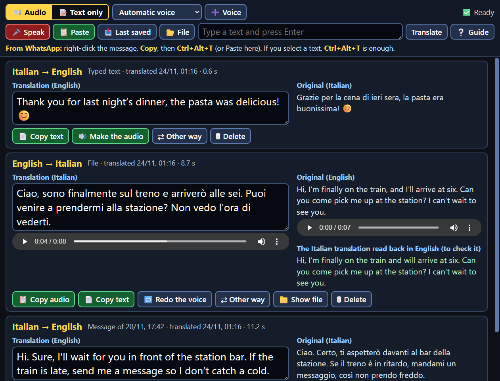
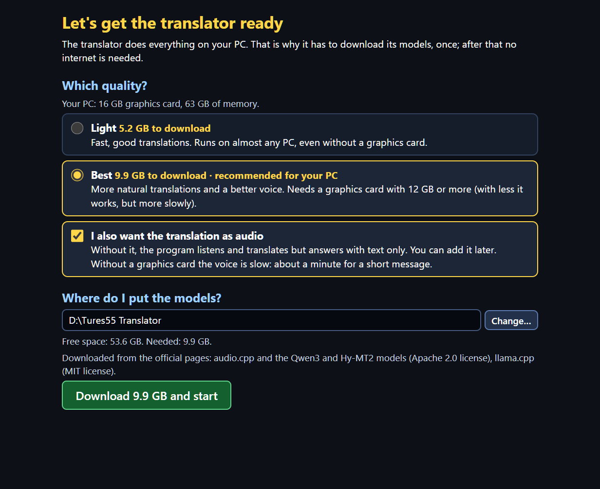
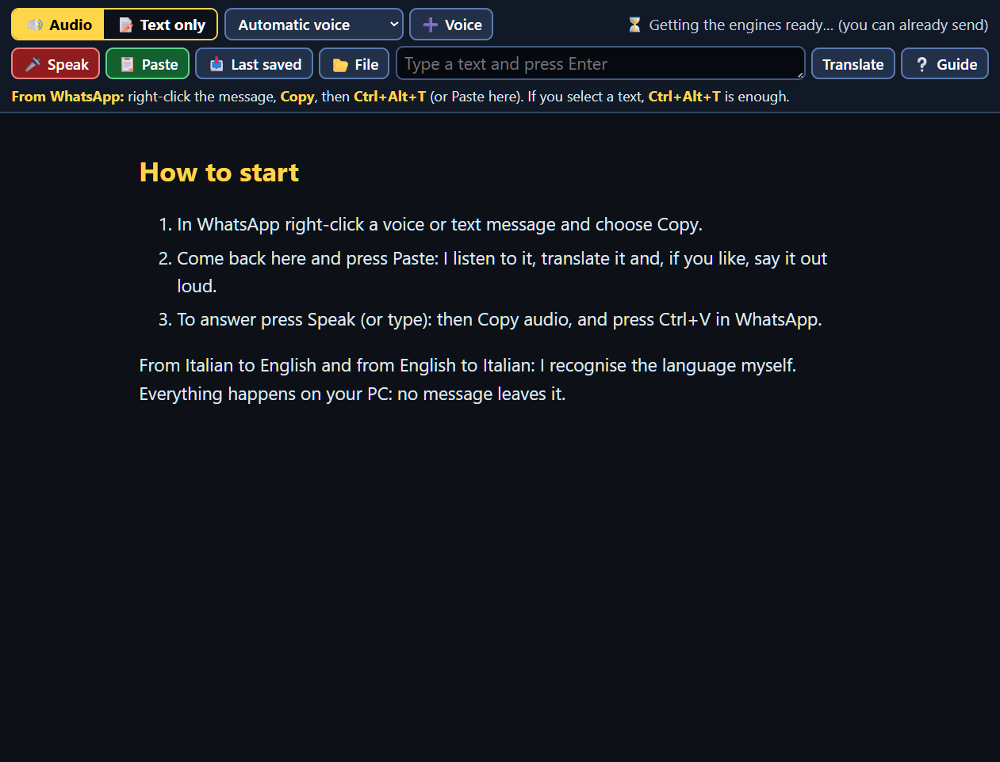

# Voice translator guide

[Guida in italiano](GUIDA.md) · [Download](https://github.com/Tures55/voice-message-translator-windows/releases/latest/download/Tures55-Translator-Setup.exe)

- [Installing](#installing)
- [What it does](#what-it-does)
- [The first time](#the-first-time)
- [Translating a message you received](#translating-a-message-you-received)
- [Answering](#answering)
- [The Ctrl+Alt+T shortcut](#the-ctrlaltt-shortcut)
- [Audio or Text only](#audio-or-text-only)
- [The languages of the messages](#the-languages-of-the-messages)
- [The voices](#the-voices)
- [Checking the translation](#checking-the-translation)
- [WhatsApp by itself](#whatsapp-by-itself)
- [Changing quality or folder](#changing-quality-or-folder)
- [Graphics card](#graphics-card)
- [Bigger text](#bigger-text)
- [Your messages](#your-messages)
- [If something goes wrong](#if-something-goes-wrong)
- [Updates](#updates)
- [What it is made with](#what-it-is-made-with)

## Installing

1. Download [Tures55-Translator-Setup.exe](https://github.com/Tures55/voice-message-translator-windows/releases/latest/download/Tures55-Translator-Setup.exe) and open it.
2. If Windows warns that the program is not recognised, press «More info» and then «Run anyway»: it happens to free programs without a paid signature.
3. Follow the steps. No administrator rights needed.

## What it does

It listens to a voice message or reads a text message, works out which of the two chosen languages it is in, translates it into the other one and, in ten languages, also says it out loud if you like. It works with WhatsApp, Telegram, email and any program you can copy from.

Everything happens on your PC: no message is sent over the internet.

## The first time

WARNING about space: the program downloads its models once. Text only: 3.2 GB (light) or 7.7 GB (best). Text and voice: 5.2 GB (light) or 10.4 GB (best).

Choose between Text only and Text and voice, then the quality (the program tells you which suits your PC best) and the folder for the models. Then press Download: if you stop it or the connection drops, it resumes where it was.

On the first opening and after an update the engines take a little longer to get ready: you can already send messages, they wait in the queue.

## Translating a message you received

1. In WhatsApp right-click the message (voice or text) and choose Copy.
2. In the translator press Paste, or Ctrl+V.

These work too:

- File: choose an audio file from the PC.
- Dragging an audio file into the window.
- Last saved: the last audio WhatsApp saved on the PC. If you have not copied or saved the latest one you received, WhatsApp does not put it on the PC: in that case use Copy.
- In File Explorer: right-click an audio file, Send to, Tures55 Translator (on Windows 11, «Show more options» first).

## Answering

Press Speak, say the message in your language and press «I'm done, translate». Or type the text and press Enter (Shift+Enter starts a new line).

Then press Copy audio (or Copy text), go to the chat and press Ctrl+V.

You can correct the translation in the big box: press Redo the voice and the audio is made again with the corrected text.

## The Ctrl+Alt+T shortcut

It works in any program as long as the translator is open. It translates what you copied and brings the translator window to the front.

With WhatsApp in front it also copies the selected text by itself.

If another program already uses these keys, the translator takes others: you see them written at the top of the window.

## Audio or Text only

The yellow switch at the top decides what you get for new messages, and it is remembered.

Text only is faster and frees the graphics card. If you then need the voice of one message, press Make the audio.

## The languages of the messages

At the top you choose your language and the other person's: they are remembered.

The translation can also be spoken in ten languages: Italian, English, Spanish, French, German, Portuguese, Russian, Chinese, Japanese and Korean. In the other languages it is text only: voice messages are still listened to and translated, but the answer is a text to copy. With one language that has a voice and one that does not, you get the voice only when translating into the first one.

If a short message is taken for the other language, press Other way.

## The voices

- Automatic voice: the messages you send come out in your own voice in the other language; those you receive are read by a voice in your language.
- Speaker's own voice: always the voice of whoever recorded the message.
- Woman's voice and Man's voice: voices included in the program, made by computer.
- ➕ Voice: adds a voice of your own from a 3-15 second recording of one person speaking, without music.

Only use your own voice or that of someone who gave you permission, and tell whoever listens that the voice was made by computer.

The voices you add are in the folder opened by Translator, «Open the folder of my voices»: to remove one, delete its two files.

## Checking the translation

When the translation is in the other language, the program reads it back in yours, in green: if the meaning is right you can send it.

If it mistook the language of the message, press Other way.

It is a machine translation and can be wrong: for important things (health, contracts, money) have a person check it.

## WhatsApp by itself

When WhatsApp for Windows saves an audio on the PC (because you copy, save or open it), the translator translates it by itself. You can switch this off in the Translator menu.

The program does not get into WhatsApp and does not read your chats: it only looks at the audio files WhatsApp puts in its folders and in Downloads.

Tures55 Translator is not made by, or connected with, WhatsApp or Meta.

## Changing quality or folder

From the Translator menu, «Quality, voice and models folder…». You can go from Light to Best, add the voice or move to another folder. Models that are no longer needed can be deleted: the program asks you.

## Graphics card

Automatic is usually fine: the program chooses the card with the most free memory, and if that is not enough it uses the processor. It works with NVIDIA, AMD and Intel cards.

After 10 minutes without work the engines switch off and free the memory; they switch on again by themselves at the next message.

## Bigger text

Ctrl and + makes it bigger, Ctrl and - smaller, Ctrl and 0 goes back to normal. The size is remembered.

The language of the program is changed from the Translator menu, Language.

## Your messages

The translations and their audio stay on your PC only. With Delete you remove one; from the Translator menu, «Delete all translations…».

The program uses the internet only to download the models, look for updates and, if you ask for it, send a report.

## If something goes wrong

- «The engine stopped»: usually the graphics card is busy with another program (for example a game). Close it and press Try again, or choose another card or the Light quality.
- Very slow: go to the Light quality or to Text only. Without a graphics card the voice takes about a minute for a short message, the text a few seconds.
- The microphone does not work: in Windows open Settings, Privacy, Microphone, and allow access to desktop apps.
- Windows warns that the program is not recognised when you install it: press «More info», then «Run anyway».

To tell the author: Help menu, «Report a problem…».

## Updates

The program updates itself: it downloads the new version and installs it when you close it. You can switch this off in the Help menu.

## What it is made with

Listening: Qwen3-ASR. Voice: Qwen3-TTS. Translation: Hy-MT3 and Hy-MT2 by Tencent (all under the Apache 2.0 license). Engines: audio.cpp (Apache 2.0) and llama.cpp (MIT). Windows: Electron (MIT). Mp3 audio: lamejs (LGPL 3.0). Clipboard: koffi (MIT).

The license texts are in the file LICENZE_TERZI.txt next to the program.
