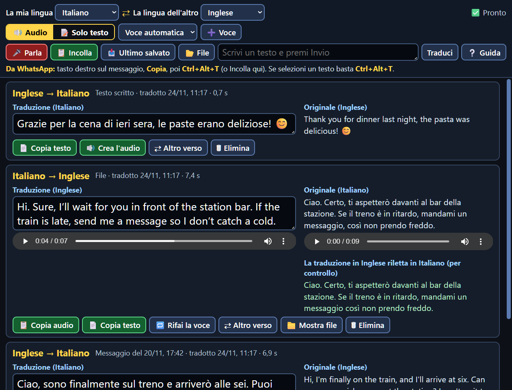
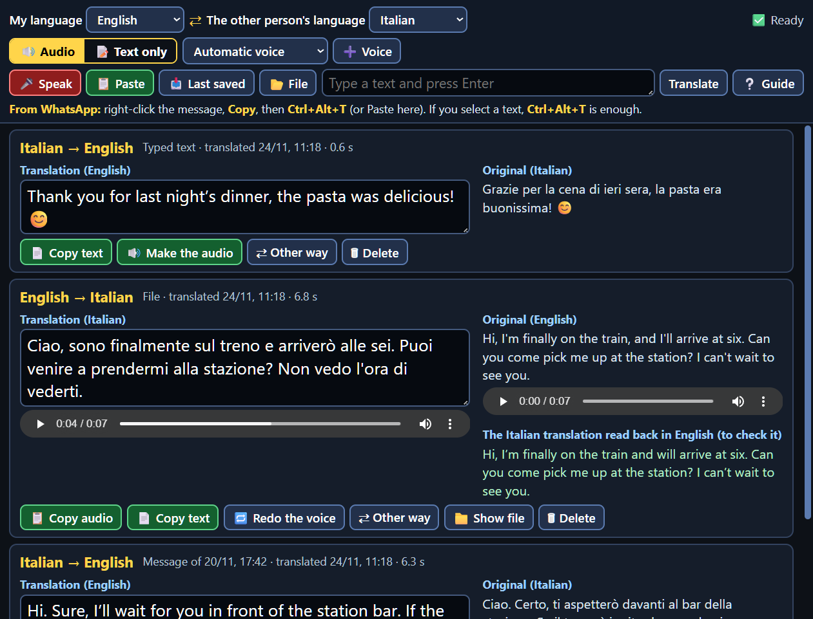

# Voice Message Translator for Windows — translate WhatsApp voice messages in 20 languages, offline

**Traduce i messaggi vocali e scritti (WhatsApp, Telegram, email…) in 20 lingue, con la voce in 10 di queste. Tutto sul tuo PC, gratis.**
**Translates voice and text messages (WhatsApp, Telegram, email…) in 20 languages, out loud in 10 of them. All on your PC, free.**

Il programma installato si chiama **Tures55 Translator**. È gratuito; il codice sorgente completo lo riceve chi fa una donazione, per uso personale.
The installed program is called **Tures55 Translator**. It is free; donors receive the complete source code, for personal use.

# ⚠️ ATTENZIONE: SERVONO DA 3 A 10 GB DI SPAZIO

# ⚠️ WARNING: 3 TO 10 GB OF SPACE NEEDED

**Il programma è piccolo, ma alla prima apertura scarica sul tuo PC i modelli con cui lavora. Scegli tu, prima di scaricare:**
**The program is small, but on first start it downloads the models it works with. You choose, before downloading:**

| | 📝 SOLO TESTO / TEXT ONLY | 🔊 TESTO E VOCE / TEXT AND VOICE |
|---|---|---|
| **Leggera / Light** | **3,2 GB** | **5,2 GB** |
| **Migliore / Best** | **7,2 GB** | **9,9 GB** |
| **PC** | Va bene anche senza scheda video. / Fine without a graphics card too. | Consigliata scheda video da **8 GB** (Migliore: **12 GB**). Senza, la voce è lenta: circa un minuto. / **8 GB** graphics card recommended (Best: **12 GB**). Without one the voice is slow: about a minute. |

**Poco spazio o un PC semplice? Scegli «Solo testo» e «Leggera»: la voce si può aggiungere dopo.**
**Little space or a basic PC? Choose “Text only” and “Light”: you can add the voice later.**

## ⬇️ Scarica / Download

### **[⬇️ Scarica Tures55 Translator per Windows / Download for Windows](https://github.com/Tures55/voice-message-translator-windows/releases/latest/download/Tures55-Translator-Setup.exe)**

Il clic scarica subito `Tures55-Translator-Setup.exe`, sempre l'ultima versione: aprilo e segui i passi. Poi il programma si aggiorna da solo.
One click downloads `Tures55-Translator-Setup.exe`, always the latest version: open it and follow the steps. The program then updates itself.

### 📖 Guida / Guide: [🇮🇹 Italiano](GUIDA.md) · [🇬🇧 English](GUIDE.md)

Tutte le versioni / All versions: [Releases](https://github.com/Tures55/voice-message-translator-windows/releases) · Novità in arrivo / Coming next: [NOVITA_IN_ARRIVO.md](NOVITA_IN_ARRIVO.md)

| 🇮🇹 Italiano | 🇬🇧 English |
|---|---|
|  |  |

### ⭐ [Ti piace? Metti una stella / Like it? Star this project](https://github.com/Tures55/voice-message-translator-windows)

Basta un clic sulla stella ⭐ in alto a destra di questa pagina: aiuta altre persone a trovarlo. / One click on the ⭐ at the top right of this page helps others find it.

### Cosa serve / What you need

- Windows 10 o 11 a 64 bit. / 64-bit Windows 10 or 11.
- Da 3 a 10 GB liberi per i modelli, scaricati una volta sola al primo avvio. / 3 to 10 GB free for the models, downloaded once on first start.
- Consigliata una scheda video NVIDIA, AMD o Intel con almeno 8 GB. Senza va lo stesso: il testo in pochi secondi, la voce in circa un minuto. / A NVIDIA, AMD or Intel graphics card with at least 8 GB is recommended. It works without one too: text in a few seconds, voice in about a minute.
- Provato su NVIDIA RTX 5070 Ti e RTX 3060 e sul solo processore; non ancora su schede AMD e Intel. / Tested on NVIDIA RTX 5070 Ti and RTX 3060 and on the processor alone; not yet on AMD and Intel cards.

---

## 🇮🇹 Italiano

- **Copia e incolla**: in WhatsApp copi il messaggio vocale, nel traduttore premi Incolla. Oppure **Ctrl+Alt+T** da qualsiasi programma.
- **Riconosce da solo** in quale delle due lingue scelte è il messaggio.
- **20 lingue**: italiano, inglese, spagnolo, francese, tedesco, portoghese, russo, cinese, giapponese, coreano (anche a voce); olandese, polacco, ceco, turco, indonesiano, vietnamita, arabo, persiano, hindi, thailandese (solo testo).
- **Risponde con la tua voce**: parli nella tua lingua e il messaggio esce nell'altra con la tua voce, pronto da incollare nella chat.
- **Rilettura di controllo**: la traduzione viene riletta nella tua lingua, così vedi se il senso è giusto.
- **Solo testo** o anche audio, come preferisci.
- **Privato**: i messaggi non escono dal PC. Internet serve solo per scaricare i modelli e gli aggiornamenti.
- Scritte grandi e contrasto alto, ingrandibili. Interfaccia e guida in italiano, inglese, spagnolo, francese, tedesco e portoghese.

Usa solo la tua voce o quella di chi ti ha dato il permesso. Le traduzioni sono automatiche e possono contenere errori. Tures55 Translator non è fatto da WhatsApp o Meta, né è collegato a loro.

### Licenza
Gratuita per uso personale. Puoi condividere l'installatore originale, gratis e senza modificarlo, indicando questa pagina ufficiale: https://github.com/Tures55/voice-message-translator-windows

Se ti è utile puoi sostenerlo: https://buymeacoffee.com/tures1955

---

## 🇬🇧 English

- **Copy and paste**: copy the voice message in WhatsApp, press Paste in the translator. Or **Ctrl+Alt+T** from any program.
- **Works out by itself** which of the two chosen languages the message is in.
- **20 languages**: Italian, English, Spanish, French, German, Portuguese, Russian, Chinese, Japanese, Korean (voice too); Dutch, Polish, Czech, Turkish, Indonesian, Vietnamese, Arabic, Persian, Hindi, Thai (text only).
- **Answers in your own voice**: you speak your language and the message comes out in the other one in your voice, ready to paste in the chat.
- **Check reading**: the translation is read back in your language, so you can see whether the meaning is right.
- **Text only** or audio too, as you prefer.
- **Private**: messages never leave the PC. Internet is only needed to download the models and the updates.
- Big text and high contrast, can be enlarged. Interface and guide in Italian, English, Spanish, French, German and Portuguese.

Only use your own voice or that of someone who gave you permission. Translations are automatic and may contain mistakes. Tures55 Translator is not made by, or connected with, WhatsApp or Meta.

### License
Free for personal use. You may share the original installer, free of charge and unmodified, linking to this official page: https://github.com/Tures55/voice-message-translator-windows

If you find it useful you can support it: https://buymeacoffee.com/tures1955

---

Fatto con / Made with: [audio.cpp](https://github.com/0xShug0/audio.cpp), [llama.cpp](https://github.com/ggml-org/llama.cpp), Qwen3-ASR, Qwen3-TTS, Hy-MT2, Electron. Le licenze sono accanto al programma, in LICENZE_TERZI.txt. / The licenses are next to the program, in LICENZE_TERZI.txt.
